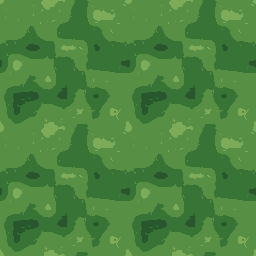
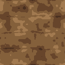
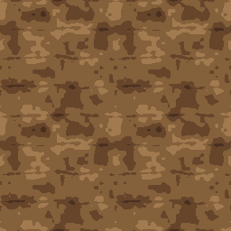

# HD-2D grass/dirt visual study

2026-10-11. The selected local study is complete. **Refine both candidates;
dirt comes first.** These are visual recommendations, not artwork approval.
Both material manifests retain `visualReview: unapproved`.

## Inputs and retained evidence

Both cases use `style-surface/1`, HD-2D, seed 1204, earth palette, 128 pixels,
strata 4, fracture 0.28, relief 0.55 and roughness 0.84. The earth setting applies
no additional pigment shift to each family's original color ramp. No generator
or recipe behavior was changed during this study.

The single [recipe/source index](studies/grass-dirt-20261011/study.json)
records normalized recipes, exact source hashes, canonical package references,
view dimensions, byte lengths, hashes, producer and retention. It binds the
working-tree generator at SHA-256
`9abd395a8bd538589334ede08c1720a401739873a822d3273af25f13d7868e82`.
HEAD was `c26d117c6de03432b469abbfc55e061778512735`; the checked local source,
rather than HEAD alone, establishes the candidate.

Existing source-matching single-seed packages were verified and reused during
the local study. For publication, the two original procedural manifests, eight
native maps, two channel strips and eight exact repeated views are now retained
byte-for-byte in this repository's [study directory](studies/grass-dirt-20261011/).
This compact review fixture is an explicit retention exception for portable
evidence; it does not promote candidates into the public texture corpus. The
original local canonical packages remain retained. No automatic retirement is
authorized. Text hashes use LF line endings to survive Git checkout conversion.

## Grass: refine the tuft structure

At native scale, the green ramp reads as vegetation, but broad four-color
islands dominate. Sparse bright flecks provide little consistent blade/tuft
direction. It reads closer to camouflage or moss patches than a coherent grass
surface. In 2×2 repetition the large dark island and surrounding broad patches
recur visibly. There is no prominent hard border seam in the inspected repeat.

The height map is a soft low-amplitude field with isolated small marks. The
normal map concentrates sharper changes around sparse blade marks while much
of the tile remains nearly flat. Roughness is a broad matte field; it does not
establish grass structure by itself. These byte-map observations do not measure
the receiving engine's world-scale relief or lighting response.

Recommendation: retain the green ramp and periodic field, reduce the dominance
of broad dark patches, and make a few connected tuft/blade clusters legible at
128 pixels. Replace isolated bright threshold flecks with coherent clusters.
Test a native tile before increasing detail or relief. Simply raising relief
would strengthen the existing sparse normal marks without resolving the albedo
readability. Do not add painted directional light to make the grass read.




## Dirt: refine the regular row structure first

The earthy ramp and medium-sized clumps give the native tile a useful soil
color/read. However, broad stepped pigment islands remain conspicuous. The
height and normal maps reveal four gently warped horizontal bands per tile;
their repetition is especially clear in the 2×2 normal view. This introduces a
layered/ridged reading instead of irregular ground clumps and local cracks.

The current dirt branch uses the common strata row phase (`rowF`) to derive
its crack term. Its height expression subtracts `(1 - crack)` while pigment
darkens `crack`, so the darker crack regions are comparatively raised by that
term. That source relationship supports investigating the ridged reading;
lighting/rendered receiving was not evaluated in this batch.

Recommendation: replace the regular row-dependent dirt fracture structure with
irregular periodic clumps and localized depressions. Align dark crack pigment
with the intended relief, while keeping dirt height and normals derived from
the same field. Retain the dry earthy ramp, unlit albedo and repeat behavior.
First resolve the broad row pattern; add sparse fine granules only if the native
tile still needs them afterward.

The small measured opposite-edge albedo jump is not a prominent hard seam in
this 2×2 view. It does not justify an edge-blending pass ahead of the structural
issue. Opposite texel-center borders are neighboring samples of a periodic
field and need not be identical.




## Matched-channel observations

Ranges are stored byte values, not physical relief units. Linear-data channels
are displayed directly for inspection; these images are not a calibrated render.
Independent in-memory measurements used the exact recipes/source above. The
study producer also checked raw albedo hashes against those measurements and
verified every canonical PNG against current deterministic encoding.

| Observation | Grass | Dirt |
| --- | ---: | ---: |
| Distinct albedo RGB colors | 4 | 4 |
| Height range | 118–144 | 109–142 |
| Normal blue range | 241–255 | 251–255 |
| Mean normal blue | 254.66 | 254.49 |
| Roughness range | 203–226 | 209–228 |
| Mean roughness | 210.16 | 218.03 |
| Mean opposite-edge albedo absolute difference, byte units | 0 | 0.58 |
| Maximum opposite-edge height difference | 1 | 1 |

The native strips below show **albedo, height, +Y tangent normal, roughness** in
that order, each at 128×128. All eight native maps and their 2×2 repeated views
were inspected. Dimensions and hashes are in the recipe/source index.


Repeated data maps:
[grass height](studies/grass-dirt-20261011/grass/grass-height-2x2.png),
[grass normal](studies/grass-dirt-20261011/grass/grass-normal-2x2.png),
[grass roughness](studies/grass-dirt-20261011/grass/grass-roughness-2x2.png),
[dirt height](studies/grass-dirt-20261011/dirt/dirt-height-2x2.png),
[dirt normal](studies/grass-dirt-20261011/dirt/dirt-normal-2x2.png),
[dirt roughness](studies/grass-dirt-20261011/dirt/dirt-roughness-2x2.png).

## Verification and boundary

The local study producer verified two exact canonical package reuses, current
PNG bytes and every repeated texel before this closeout. The repository fixture
can now be verified without that ignored cache:

```powershell
node docs/look-dev/studies/grass-dirt-20261011/verify.mjs
```

The [read-only verifier](studies/grass-dirt-20261011/verify.mjs) binds the three
authoring sources, both recipes/manifests, every retained file and the exact
native/repeated PNG encodings. It writes no files and starts no process or server.
Its observed result was exit 0, with 21 references, eight native maps and eight
repeated maps verified; [the compact receipt](studies/grass-dirt-20261011/verification.json)
records the result. The eight repeated PNGs total 152,021 bytes. Source changes
in a future refinement require a new comparison record; this fixture remains
the historical baseline.

The earlier full cleanup checks are reused after all 14 recorded source hashes
matched. [The portable closeout record](closeout-20261011.json) retains those
source hashes, exact commands and the two browser result summaries. Full logs,
captures and earlier failed diagnostics remain local. App builds, full unit
suites and the browser matrix were not rerun for this evidence/docs batch; no
app source or dependencies changed.

No new architect feedback or research-inbox packet was present. The existing
handoff was verified actionable and completed against its Done When criteria.
The earlier technical cleanup remains verified complete. Art approval, public
promotion, new families and cross-repository receiving are outside this batch.
The next bounded dirt refinement is recorded in [our TODO](../TODO.md).

AI-edited: 2026-10-11 | agent=Codex/root | model=unknown | effort=unknown | task=grass-dirt-study | change=recorded native/repeated material observations, recommendations, source proof and scope

AI-edited: 2026-10-11 | agent=Codex/root | model=unknown | effort=unknown | task=closeout-publish | change=made compact original study evidence and verification portable without art promotion
