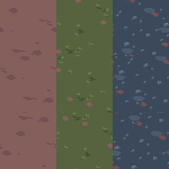
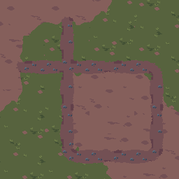

# Retro terrain: paths, wear and curated drawing

The new growth recipe supplies 70 native 64×64 tiles: three surfaces and sixteen
grass/dirt cases, nineteen weathered counterparts, sixteen gravel path cutouts
and sixteen weathered path cutouts. Four 256×256 atlases accompany them. The
original `retro-terrain` recipe, generator and reviewed pixels remain unchanged
and separately selectable. The growth recipe has its own drawings and identity.
Artwork remains **unapproved**.

## Drawing decisions

The first growth draft carried forward too much granular noise and shaded stone
detail. The user rejected its pixelated appearance. Palette limits, nearest
sampling and exact exports did not establish pixel-art craft.

The revised source uses editable symbol maps and deliberate native layouts.
Grass has grouped leaf wedges over quiet ground, with varied stepped shadow
planes. Dirt has muted ground planes and sparse connected divots. Gravel uses
six drawn angular chip aggregates and irregular anchors, with flat color planes.
These drawings are authored in `src/shader/retro-terrain-growth.mjs`; they are
neither resized imagery nor extracted purchased shapes. Seeds shift complete
clusters on the periodic grid.

Wear removes whole tufts or stones and adds compacted soil planes, rather than
sprinkling noise over the image. Paths reuse the material vocabulary inside
rounded bends and rough soil shoulders. Paths narrow within a tile and retain
twenty-pixel boundary mouths; complete chip groups fit within the shoulder.
Detached shoulder specks are removed. Native drawings, exact 3× enlargement,
repeats and connected patches are reviewed separately from structural tests.

The grass/soil motif pass breaks the dark oval beds into open root shadows,
interrupts tuft rims with ground-colored gaps, and reserves a few brighter leaf
tips. Soil depressions use short, connected planes with incomplete edges instead
of highlighted bowls. Colonies have different footprints so repeated tiles do
not all lean along the same diagonal. Native and exact 3× boards, 4×4 surface
repeats and the connected path scene are retained under
`.artifacts/proof/retro-terrain-growth/motif-polish-20261011/`. This pass changes
only growth grass/soil drawings; classic terrain, gravel and path drawings stay
intact. The base remains periodic and artwork still awaits owner approval.

The requested consultation with [Review repository and pass down](codex://threads/01a10aa2-1783-7521-937e-2d3145e85f24)
identified repeated stamps and a paved path impression. Its accepted changes
were uneven colonies and soil planes, restrained highlights, connected stone
faces, and exposed earth between gravel groups. The agent rechecked those
changes, then completed the owner-requested grass/soil motif polish. Technical
checks establish reproducibility and connectivity; the remaining visual decision
is whether the periodic base has enough character and variation for the project.

Heath is an independently authored sage/rose-soil/slate palette; Riverbed uses
teal/clay/cool stone. Both retain eight grass, twelve dirt and twelve gravel
color roles. Weathered grass may use grass plus soil colors; weathered gravel
and paths may use gravel plus soil colors. These mixed materials declare their
ramps rather than silently adding shades. Original colors remain an option.
No purchased pixels, ramps, masks, training data or redistributed reference
images are inputs.

## Authoring and exports

Open **Adjust → Retro terrain · 64 px → Paths and weathering**. Choose the
palette and seed, then inspect surfaces, transition/path sheets and connected
terrain. Surface repeats expose periodic motifs; variation previews compare
four spatially selected phases of the same curated board. Draft recovery, errors, export retry
and cancellation use the existing exclusive-preview workflow.
These phase-shift previews are diagnostic; they are not independently authored
variants. No new variants are added before the base drawing review.
The large retro preview uses integer device-pixel magnification; a native sheet
that exceeds a small stage can scroll instead of being stretched unevenly.

```json
{"id":"retro-terrain-growth","seed":1204,"palette":"heath"}
```

```powershell
npm run bake:retro-terrain-growth -- --seed 1204 --palette heath --out .artifacts/retro-terrain-growth
```

Palettes are `original`, `heath` and `riverbed`. Omitting the palette in a
recipe selects `original`; a new UI draft selects Heath. A CLI palette must
agree with an explicitly supplied recipe. Unknown fields, invalid seeds or
palette conflicts fail before generation. Export contains 74 PNGs, the editable
recipe and a `retro-terrain-pack/1` manifest. Browser and CLI encodings differ;
decoded RGBA is their common contract. Caches are source-addressed, bounded and
validated against regenerated bytes. Completed historical bakes are retained.

Path bits are **N=1, E=2, S=4, W=8**, distinct from grass/dirt corner bits.
All sixteen masks are supplied, including the empty layer. A path mouth is
twenty native pixels wide; cutouts have alpha 0 or 255, with zero RGB outside.
Composite them over compatible terrain and match adjoining path ports. The
manifest records masks, alpha, atlas paths/coordinates, palettes and provenance.
Terrain remains opaque; no PBR channels or engine integration are added.

## Repetition study

The supplied [Godot sampler](https://godotshaders.com/shader/seamless-texture-sampler-without-repeating-patterns-tiling/)
uses a noise lookup and two offset samples with a blend. The
[jMonkeyEngine discussion](https://hub.jmonkeyengine.org/t/techniques-to-reduce-terrain-texture-repeating-effect/45623/14)
explores noise-driven UV offsets and mixing texture scales. They address
sampling repetition; they cannot curate a weak source drawing.

Our current CPU preview selects four native seed phases spatially, preserving
finite colors and compatible corner/path boundaries. Its manifest records
`[seed, seed+11, seed+29, seed+47]`, wrapping uint32 seeds. It demonstrates reduced
alignment of motifs without interpolated colors or rotated path masks. Variation
previews are not additional PNGs in the kit: bake the listed recipes to obtain
the diagnostic phases. Their shared landmarks remain recognizable. Runtime noise sampling, macro
blending and engine-specific performance proof remain a separate receiving pass.

## Retained candidates

The [source-bound study](studies/retro-terrain-growth-20261011/study.json) and
read-only verifier retain original-only native surfaces, repeats, palettes and
connected terrain. The original kit's earlier verifier remains runnable.




```powershell
node docs/look-dev/studies/retro-terrain-growth-20261011/verify.mjs
node docs/look-dev/studies/retro-terrain-20261011/verify.mjs
```

Verification and remaining acceptance are recorded in [TODO](../TODO.md) and
the [growth receipt](retro-terrain-growth-proof.json). Technical closure does
not approve the drawing. Subsequent masonry, timber and metal work follows
visual acceptance; the earlier multi-channel dirt refinement stays open.

AI-created: 2026-10-11 | agent=Codex/root | model=unknown | effort=unknown | task=retro-terrain-growth | change=recorded native drawing revision, original palettes, paths and repetition study
