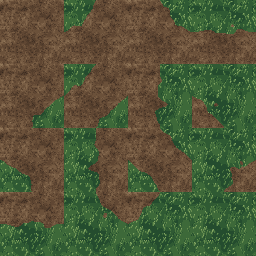
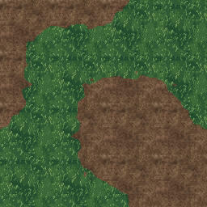
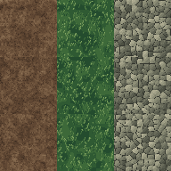
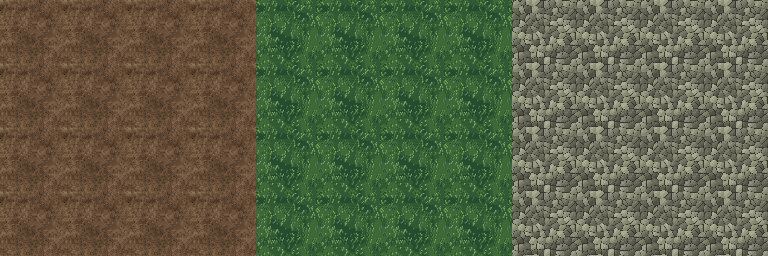

# Original retro terrain kit

The mill now authors a separate 64×64 retro color kit: dirt, grass, gravel and
sixteen connecting grass/dirt tiles. All drawing geometry, color ramps and
seeded placement are original source code. Purchased pixels, palettes, grayscale
conversions and masks are not inputs. These candidates remain visually unapproved.

## Study and drawing contract

We inspected the supplied local RETRO_TEXTURES_V28 pack without changing it.
Its 746 static PNGs include 713 at 64×64; it also supplies sixteen animated sets.
The observed styles vary: simple grass uses connected short marks and a small
ramp, dirt has quiet mottling and granules, gravel uses irregular stone planes,
and masonry/wood/metal emphasize their own material clusters. A single noisy
filter does not establish that drawing language.

The author's [usage terms](https://little-martian.itch.io/retro-textures-pack)
allow commercial works but exclude texture redistribution, including modified
versions. The local README also excludes AI training. This kit uses independently
authored recipes informed by broad drawing observations. The purchased pack
stays a local reference and is absent from repository fixtures and exports.

The new native-grid contract is opaque RGBA at 64×64, with independent ramp
budgets of eight grass, twelve dirt and twelve gravel colors. Grass uses short
forked strokes with varied gaps, dirt uses muted periodic grain without row
bands, and gravel uses packed irregular cells with small plane highlights.
These are authored retro color images, not unlit PBR albedo; no height, normal
or roughness channel is fabricated. Existing material recipes remain unchanged.

## Authoring and exports

Open **Adjust → Retro terrain · 64 px**. Select a seed, surface or transition,
preview the transition sheet or connected patch, and save the kit. Repeat
preview applies to standalone surfaces; transitions connect by matching corners.
Material and retro disclosures share one active preview. Draft recovery and
export errors stay visible; changing a seed during export preserves the newer
draft while exporting the captured seed.

```powershell
npm run bake:retro-terrain -- --seed 1204 --out .artifacts/retro-terrain
```

The editable recipe is deliberately small:

```json
{"id":"retro-terrain","seed":1204}
```

Seeds are unsigned 32-bit integers. Native size is fixed at 64 for this version.
Optional `--recipe <path>` must agree with `--seed`; unknown settings/flags fail.
CLI output contains twenty PNGs (nineteen tiles plus the atlas), `recipe.json`
and `terrain.json`. Browser export packages those same pixels in a ZIP. PNG
encodings and source identities may differ between environments; decoded RGBA
is the shared pixel contract.

`retro-terrain-pack/1` records normalized recipe, generator/source identities,
tile roles, dimensions, corner masks, atlas coordinates, nearest/sRGB sampling,
encoded PNG hashes and raw `rgbaSha256` hashes. It retains original provenance,
`restrictedInputs: []`, `training: false` and `visualReview: unapproved`.
The CLI addresses completed outputs by recipe/source identity, bounds file reads,
regenerates exact expected cache bytes, rejects coordinated metadata/pixel
tampering and removes only its own pending output on cancellation. Historical
completed packages are retained when authoring source changes.

## Connecting tiles

Corner bits are **NW=1, NE=2, SE=4, SW=8**; a set bit means grass. Mask zero is
dirt, mask fifteen is grass. The two diagonal cases preserve separate grass
corners. Atlas mask `m` starts at `x=(m%4)*64`, `y=floor(m/4)*64` in a 256×256
image. Boundary terrain profiles depend only on the shared corner pair; interior
irregularity does not alter that contract. Adjacent texture colors retain their
normal periodic texel variation rather than forcing an artificial border frame.




## Original-only review evidence

The [compact source/recipe record](studies/retro-terrain-20261011/study.json)
binds seven original PNGs totaling 92,109 bytes. Native seed rows below are 1204,
1215 and 1233; columns are dirt, grass and gravel. This is a reviewed candidate
baseline, not approval or a redistributable copy of the reference pack.




The read-only verifier regenerates these exact images from their source snapshot:

```powershell
node docs/look-dev/studies/retro-terrain-20261011/verify.mjs
```

The native tiles and exact 3× enlargement read as distinct surfaces. Dirt has
fine grain and quiet mottling with no strata rows. Grass has connected marks
and resting areas rather than dominant broad four-color islands. Gravel has
packed angular stones rather than isolated regular dots. Repeated patches show
no prominent hard border seam; a repeated seed still repeats its arrangement,
so callers should select variants when larger areas need variation.

Technical/browser proof and remaining work are recorded in [our TODO](../TODO.md).
The [growth pass](retro-terrain-growth.md) now adds gravel paths, weathered
drawings and original palette choices, preserving this original recipe.
After visual acceptance, grow through masonry, timber and metal. PBR material maps and engine receiving remain
separate work; no Phaser dependency or public corpus promotion was added.

AI-edited: 2026-10-11 | agent=Codex/root | model=unknown | effort=unknown | task=retro-terrain | change=recorded independent style study, native drawing and export/connection contracts

AI-edited: 2026-10-11 | agent=Codex/root | model=unknown | effort=unknown | task=retro-terrain-growth | change=linked additive growth while preserving the original recipe
